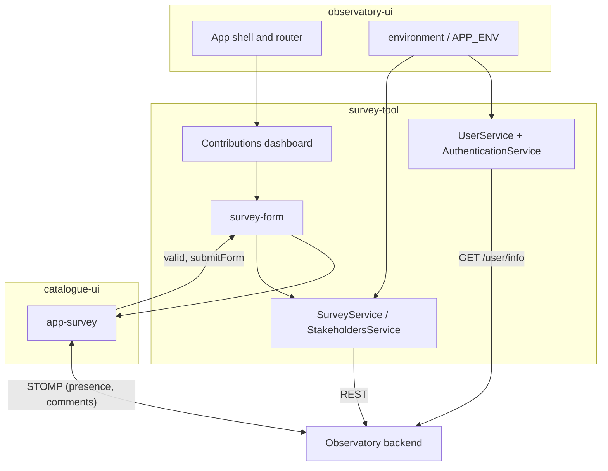

# Architecture

## Purpose and responsibilities

survey-tool implements the **contributions area** of the Observatory frontend and the session handling around it:

- a role-aware dashboard (stakeholder, coordinator, administrator) with a side menu built from the user's groups;
- survey answering: list of the user's surveys, the survey form (rendered by catalogue-ui), answer history and version
  comparison, validation of an answer, PDF export, live co-editing and comments;
- group management: members and managers of stakeholder groups, coordinators and administrators, invitations;
- survey templates for coordinators and administrators: activate, lock, edit dates, generate answers, notification
  settings per survey type;
- the user profile and notification preferences, privacy-policy acceptance and a support page;
- the form builder entry routes (`/fb/**`) that host catalogue-ui's builder;
- the session services used by the whole application: `UserService`, `AuthenticationService`, `AuthGuard`.

**Out of scope.** No form rendering or form model logic (catalogue-ui), no messaging (messaging-system-ui), no
public dashboards, charts or country pages (observatory-ui). It does not persist anything itself and does not enforce
permissions: the backend does.

## Structure

| Area | Location | Notes |
|---|---|---|
| Module and routes | `app/survey-tool.module.ts`, `app/survey-tool-routing.module.ts` | `SurveyToolModule` provides `AuthenticationService`, `SurveyService` and the mentionable-users provider; routes `fb`, `fb/new-form`, `fb/:id/edit`, `invitation/accept/:invitationToken`, `profile`, lazy `contributions/:id` |
| Dashboard shell | `app/pages/contributions-dashboard` | `ContributionsDashboardComponent` builds the side menu per role; lazy `ContributionsDashboardModule` |
| Dashboard pages | same folder | `home`, `my-surveys` (cards and `survey-form`), `survey-history`, `my-group`, `coordinators` (members, surveys), `administrators` (surveys, stakeholders), `support-page`, `survey-template-card`/`-table`, `survey-modals`, `notification-settings-drawer` |
| Invitations and profile | `app/pages/accept-invitation.component.ts`, `app/pages/user-profile` | |
| Services | `app/services` | See below |
| Layout components | `app/shared/dashboard-side-menu`, `page-content`, `icons`, `reusablecomponents` | Side menu with `DashboardSideMenuService` (route `data` flags `hasSidebar`, `hasHeader`, `showFooter`, `hasAdminMenu`), mobile toggle, 403 page. `reusablecomponents/cookie-law` is an older cookie banner no longer referenced; the host's cookie-consent component is used |
| Domain | `app/domain` | `userInfo.ts` (`UserInfo`, `Stakeholder`, `Coordinator`, `Administrator`, `User`, `Profile`, `Settings`), `survey.ts`, `analytics.ts`, `privacy-policy.ts`, `url-parameter.ts` |
| Assets and styles | `assets/` (`images`, `js/sockjs.min.js`, `js/stomp.min.js`, `survey-tool-theme`), `styles/styles.less` | Added to the host build by `angular.json` |
| Host bridge | `environments/environment.ts` | Re-exports the host's `environment` so catalogue-ui and local code share one object |

### Services

| Service | Responsibility |
|---|---|
| `UserService` | Loads `GET /user/info`, caches it (and in `sessionStorage`), refreshes it every 60 minutes, tracks the active stakeholder/coordinator/administrator, profile and settings calls |
| `AuthenticationService` | Starts login (full-page redirect to `API_LOGIN`), remembers the return path, logout, `authenticated` flag |
| `AuthGuard` (`auth-guard.service.ts`) | Route guard: requires a logged-in user, otherwise starts the login |
| `StakeholderManagerGuard` | Checks that the user is an admin of the stakeholder; **defined but not attached to any route** |
| `SurveyService` | Surveys, answers, versions, history, validation, invitations, group member management, notification settings |
| `StakeholdersService` | Stakeholders, coordinators, administrators, their members, page-view analytics |
| `NotificationSettingsService` | State of the survey notification settings drawer (signals) |
| `PrivacyPolicyService` | Reads the acceptance status of a privacy policy |
| `StakeholderMentionableUsersProvider` | Supplies catalogue-ui's @-mention list from the stakeholder's members and public managers (cached per stakeholder) |
| `CompressImageService` | Client-side compression of the profile picture |
| `SurveyModalsService` | Opens the shared survey modals (edit dates, confirmations) |

## Routes registered by this module

| Path | Component | Guard |
|---|---|---|
| `fb`, `fb/new-form`, `fb/:id/edit` | catalogue-ui `FormsListComponent`, `FormBuilderComponent` | `AuthGuard` |
| `invitation/accept/:invitationToken` | `AcceptInvitationComponent` | `AuthGuard` |
| `profile` | `UserProfileComponent` | none |
| `contributions/:id/**` | Lazy `ContributionsDashboardModule`: `home`, `mySurveys[/:surveyId/answer[/view\|/validate]]`, `mySurveys/:surveyId/:answerId/history`, `surveys[/:surveyId/:answerId/history]`, `surveyTemplates[/:surveyId/freeView]`, `admin-surveyTemplates[/:surveyId/freeView]`, `stakeholder/:stakeholderId/survey/:surveyId/view`, `my-group/:group`, `stakeholders[/:id]`, `stakeholders-admin[/:id]`, `coordinators`, `support` | `AuthGuard` on every route |

The host (observatory-ui) adds the role homes (`stakeholder`, `coordinator`, `administrator`, `news-and-stories`) and mounts
this module under an empty path as the fallback.

## Data flow

Answering a survey: `survey-form` fetches the latest answer (`/answers/latest`) and the survey model (`/surveys/{id}`), opens the
presence socket as soon as the answer id is known, passes both to `app-survey` with `enableWebsocket` and
`enableCommenting`, and saves with `PUT /answers/{id}/answer` when `app-survey` emits `submitForm`.

## Persistence and client-side state

No browser database. `sessionStorage` keys written by this module: `userInfo`, `currentStakeholder`,
`currentCoordinator`, `currentAdministrator`, `redirectUrl`. Everything else is held in service state (RxJS
subjects and signals).

## Authentication and authorisation relationship

Authentication is a server session; the module only discovers it through `GET /user/info` and starts the login
redirect. Authorisation comes from the groups in that response; `AuthGuard` only checks that a session exists, and the
role-based menu and screens are conveniences on top of backend enforcement. See [security.md](security.md).

## Constraints and decisions

- **Not independently buildable.** It imports from the host: `../../environments/environment`, `HomeComponent`
  (declared in `SurveyToolModule`) and `SharedModule` from `src/app`, and observatory-ui imports from it in turn. Any
  host must provide equivalents at the same relative paths, or the imports need to be refactored.
- Route components are mixed NgModule-declared and standalone; new code should prefer standalone components with
  signals, as the recent changes do.
- catalogue-ui is nested (`catalogue-ui/`) rather than a sibling, so the host's `angular.json` also lists
  `src/survey-tool/catalogue-ui/assets`.
