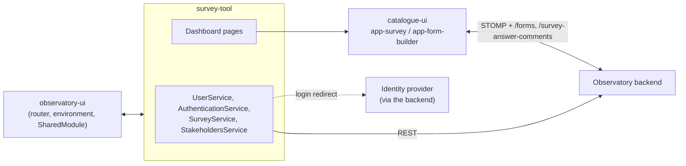

# Integration

survey-tool calls the Observatory backend through `API_ENDPOINT`, embeds catalogue-ui for forms, and is hosted by
observatory-ui. Endpoint paths, parameters and schemas are owned by the backend's Swagger/OpenAPI documentation
(TODO(backend maintainers): link); this document lists the endpoint **groups** the module depends on.

## Integrations

| Counterpart | Direction | Purpose | Protocol | Endpoint configuration | Authentication |
|---|---|---|---|---|---|
| Observatory backend | survey-tool → backend | Session discovery, groups, surveys, answers, invitations, analytics, profile | REST/JSON | `API_ENDPOINT` | Session cookie; XSRF header on state-changing calls |
| Identity provider | Browser → backend → IdP | Login | Full-page redirect to `API_LOGIN`, then back to the stored path | `API_LOGIN` | Handled by the backend |
| catalogue-ui | survey-tool → library | Render and build forms, comments, presence, PDF | Angular component inputs/outputs, DI tokens | `APP_ENV` | none; the library reuses the session |
| observatory-ui (host) | Host → survey-tool and back | Routing shell, environment, `HomeComponent`, `SharedModule`; the host imports the module and survey-tool components | Angular modules and imports | `angular.json` | none |
| messaging-system-ui | Shares services | Uses `UserService` and the `URLParameter` model from this module | TypeScript imports | none | none |

## Backend endpoint groups used

| Group | Used for | Service |
|---|---|---|
| `/user/info`, `/user/policies/{id}`, `/privacy/policies/status`, `/logout` | Session, policy acceptance | `UserService`, `PrivacyPolicyService`, `AuthenticationService` |
| `/users/{id}/profile`, `/users/{id}/profile/picture`, `/users/{id}/settings` | Profile, picture, notification preferences | `UserService` |
| `/stakeholders`, `/stakeholders/{id}`, `/stakeholders/countries`, `.../users`, `.../managers[/public]`, `.../contributors/{email}` | Stakeholder groups and membership | `StakeholdersService`, `SurveyService` |
| `/coordinators`, `/coordinators/{id}`, `.../members`, `.../users` | Coordinator groups | `StakeholdersService` |
| `/administrators`, `/administrators/{id}`, `.../users` | Administrator groups | `StakeholdersService` |
| `/surveys`, `/surveys/{id}`, `/surveys/{id}/answers/validated`, `/surveys/types/{type}/settings` | Survey templates and notification settings | `SurveyService` |
| `/answers/latest`, `/answers/{id}`, `/answers/{id}/answer`, `.../versions/*`, `.../history`, `.../validation`, `.../import/{modelId}`, `/answers/info`, `/answers/generate/{surveyId}`, `/answers/public*` | Answering, history, validation, bulk generation | `SurveyService` |
| `/invitation`, `/invitation/accept` | Invite a person to a group and accept the invitation | `SurveyService`, `AcceptInvitationComponent` |
| `/permissions?resourceIds=` | Permissions for listed resources | `SurveyService` |
| `/csv/export/answers/{id}` | Answers export (the call is currently commented out in `SurveyService`) | `SurveyService` |
| `/analytics/pageviews*` | Page-view statistics on dashboards | `StakeholdersService` |

Presence and comments are covered by catalogue-ui (`WS_ENDPOINT`, STOMP topics, `/survey-answer-comments`); the survey
form turns both on with `enableWebsocket` and `enableCommenting`.

## Extension point provided to catalogue-ui

`StakeholderMentionableUsersProvider` implements catalogue-ui's `MentionableUsersProvider`. For the current stakeholder id it
combines the group's members, admins and public managers (`.../users`, `.../managers/public`), de-duplicates by e-mail
and caches the result for the session of the page.

## Failure behaviour

- **No retries or timeouts** are applied in this module; calls fail through to the component. The host interceptor
  turns `401` into a cleared user and `403` into a notification plus navigation to `/home`.
- **`/user/info` failing** makes `AuthGuard` start the login redirect; the same call is repeated every 60 minutes and a
  failure clears the cached user.
- **Invitation acceptance** shows the server's error message on the page and leaves the user there; on success the user info is
  refreshed and the user is sent to `/`.
- **Presence/comments sockets** reconnect automatically (see catalogue-ui); the survey form remains editable and can still be saved over REST.
- **Notification settings** fall back to "all notifications off, 1 day" defaults if the settings call fails.
